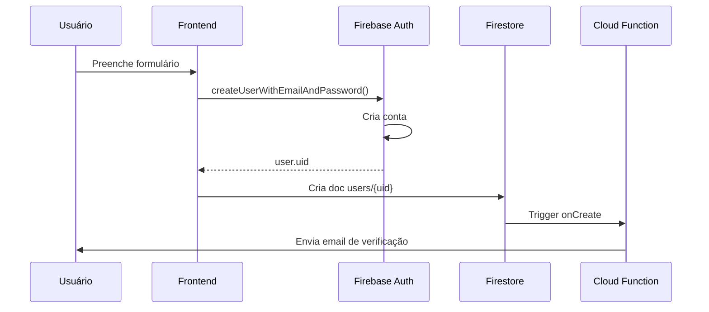
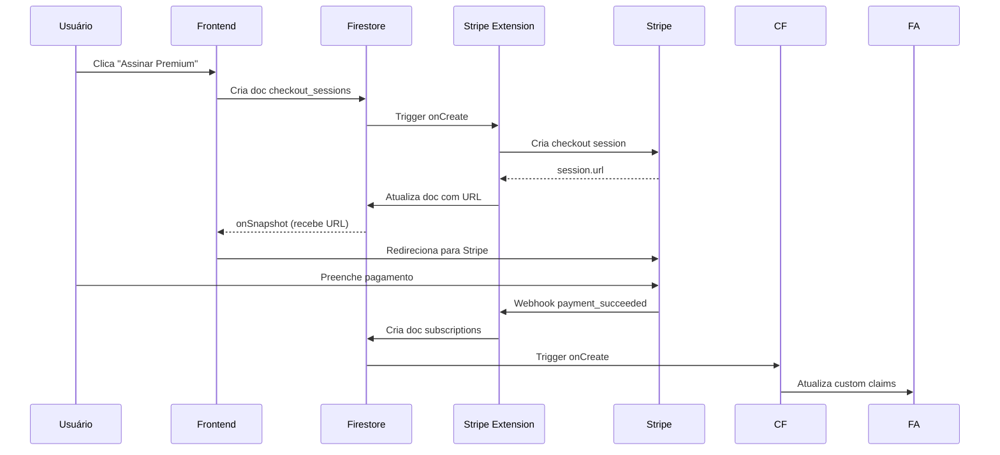
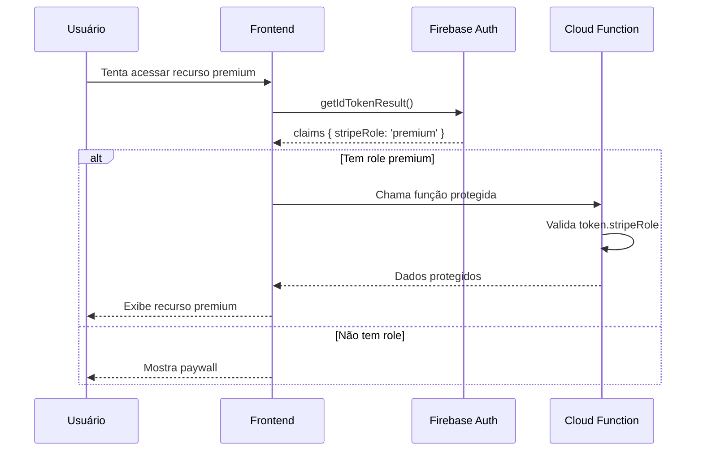

# 🔥 Arquitetura Firebase - Nova Diretriz Arquitetural

> **Status:** ⚠️ **MUDANÇA ARQUITETURAL COMPLETA**  
> **Data:** Outubro 2025  
> **Impacto:** Substituição total do backend Java/PostgreSQL por Firebase

---

## 📋 Índice

1. [Visão Geral](#visão-geral)
2. [Mudança Arquitetural](#mudança-arquitetural)
3. [Stack Tecnológica Firebase](#stack-tecnológica-firebase)
4. [Fontes da Verdade](#fontes-da-verdade)
5. [Integração Stripe com Extensão](#integração-stripe-com-extensão)
6. [Cloud Functions Customizadas](#cloud-functions-customizadas)
7. [Modelo de Dados Firestore](#modelo-de-dados-firestore)
8. [Fluxos Principais](#fluxos-principais)
9. [Segurança e Regras](#segurança-e-regras)
10. [Vantagens da Nova Arquitetura](#vantagens-da-nova-arquitetura)

---

## 🎯 Visão Geral

### Premissa Fundamental

**TODA a arquitetura do projeto de gestão de mensalidades será baseada na plataforma Firebase.**

As instruções anteriores sobre backend Java/Spring Boot com PostgreSQL estão **obsoletas** e devem ser desconsideradas.

### Projeto Atual vs. Nova Arquitetura

| Componente | Arquitetura Antiga | Nova Arquitetura Firebase |
|------------|-------------------|---------------------------|
| **Autenticação** | JWT customizado + Spring Security | **Firebase Authentication** |
| **Banco de Dados** | PostgreSQL (Relacional) | **Cloud Firestore** (NoSQL) |
| **Backend** | Java Spring Boot | **Cloud Functions** (TypeScript/JS) |
| **Hospedagem API** | Servidor dedicado | Firebase Functions |
| **Hospedagem Frontend** | Separado | **Firebase Hosting** |
| **Integração Stripe** | SDK Java direto | **Stripe Extension** (oficial) |
| **Webhooks Stripe** | Implementação manual | **Automático** (via extensão) |
| **Infraestrutura** | Docker + PostgreSQL | **Serverless** (gerenciado) |

---

## 🔄 Mudança Arquitetural

### De: Arquitetura Tradicional (3-tier)

```
┌─────────────────────────────────────────────────┐
│              Frontend (SPA)                      │
└─────────────────────────────────────────────────┘
                      ↓ HTTP/REST
┌─────────────────────────────────────────────────┐
│         Backend Java Spring Boot                 │
│  • JWT Authentication                            │
│  • Spring Security                               │
│  • REST Controllers                              │
│  • Business Logic                                │
│  • Stripe SDK Integration                        │
└─────────────────────────────────────────────────┘
                      ↓ JDBC
┌─────────────────────────────────────────────────┐
│          PostgreSQL Database                     │
│  • Users Table                                   │
│  • Subscriptions Table                           │
│  • Relational Schema                             │
└─────────────────────────────────────────────────┘
```

### Para: Arquitetura Serverless Firebase

```
┌─────────────────────────────────────────────────┐
│         Frontend SPA (React/Vue/Angular)         │
│              Firebase Hosting                    │
└─────────────────────────────────────────────────┘
                      ↓
┌─────────────────────────────────────────────────┐
│           Firebase Authentication                │
│  • Email/Password                                │
│  • Google OAuth                                  │
│  • Token Management (automático)                 │
└─────────────────────────────────────────────────┘
                      ↓
┌─────────────────────────────────────────────────┐
│            Cloud Firestore                       │
│  • users (collection)                            │
│  • customers (collection)                        │
│  • subscriptions (collection)                    │
│  • products (collection)                         │
└─────────────────────────────────────────────────┘
                      ↓
┌─────────────────────────────────────────────────┐
│          Cloud Functions (TypeScript)            │
│  • Lógica de negócio complementar                │
│  • Triggers Firestore                            │
│  • Triggers Auth                                 │
└─────────────────────────────────────────────────┘
                      ↓
┌─────────────────────────────────────────────────┐
│     Stripe Extension (Run Payments)              │
│  • Sync automático Stripe ↔ Firestore           │
│  • Webhooks configurados automaticamente         │
│  • Criação de Customer automática                │
└─────────────────────────────────────────────────┘
```

---

## 🛠️ Stack Tecnológica Firebase

### 1. **Frontend**
- **Framework:** React / Vue.js / Angular (a definir)
- **Hospedagem:** Firebase Hosting
- **SDK:** Firebase JavaScript SDK
- **Estado:** Context API / Zustand / Redux
- **Estilização:** TailwindCSS / Material-UI

### 2. **Autenticação**
- **Serviço:** Firebase Authentication
- **Providers:**
  - Email/Password (primário)
  - Google OAuth (opcional)
  - Facebook OAuth (opcional)

### 3. **Banco de Dados**
- **Serviço:** Cloud Firestore
- **Tipo:** NoSQL (documento-orientado)
- **Modo:** Native Mode
- **Região:** us-central1 (ou mais próxima do Brasil)

### 4. **Backend Logic**
- **Serviço:** Cloud Functions for Firebase
- **Linguagem:** TypeScript
- **Runtime:** Node.js 20
- **Triggers:**
  - HTTP (callable functions)
  - Firestore (onCreate, onUpdate, onDelete)
  - Auth (onCreate, onDelete)
  - Scheduled (cron jobs)

### 5. **Pagamentos**
- **Extensão:** Run Payments with Stripe (oficial)
- **Versão:** Latest
- **Modo:** Test + Production

### 6. **Monitoramento**
- Firebase Console
- Cloud Functions Logs
- Firestore Usage Dashboard
- Stripe Dashboard

---

## 🎯 Fontes da Verdade

### 1. Autenticação → **Firebase Authentication**

**Firebase Auth é a ÚNICA fonte de verdade para identidade de usuários.**

```typescript
// ✅ CORRETO: Usar Firebase Auth
import { getAuth, createUserWithEmailAndPassword } from 'firebase/auth';

const auth = getAuth();
const userCredential = await createUserWithEmailAndPassword(auth, email, password);
const user = userCredential.user; // user.uid é o ID único
```

```java
// ❌ INCORRETO: Criar sistema JWT customizado
// NÃO FAÇA ISSO - Firebase Auth já gerencia tokens
class JwtTokenProvider {
  generateToken() { ... }
}
```

**Funcionalidades automáticas:**
- ✅ Geração de tokens JWT (ID tokens)
- ✅ Refresh tokens
- ✅ Expiração e renovação automática
- ✅ Email verification
- ✅ Password reset
- ✅ Multi-factor authentication (2FA)

### 2. Banco de Dados → **Cloud Firestore**

**Firestore é a única fonte de dados persistidos.**

```typescript
// ✅ CORRETO: Modelo de coleções e documentos
import { getFirestore, collection, doc, setDoc } from 'firebase/firestore';

const db = getFirestore();
await setDoc(doc(db, 'users', userId), {
  name: 'João Silva',
  email: 'joao@example.com',
  createdAt: serverTimestamp()
});
```

```sql
-- ❌ INCORRETO: PostgreSQL schema
-- NÃO MAIS NECESSÁRIO
CREATE TABLE users (
  id SERIAL PRIMARY KEY,
  name VARCHAR(100),
  email VARCHAR(100) UNIQUE
);
```

### 3. Backend Logic → **Cloud Functions**

**Cloud Functions para lógica de negócio customizada.**

```typescript
// ✅ CORRETO: Cloud Function
import * as functions from 'firebase-functions';

export const sendWelcomeEmail = functions.auth.user().onCreate(async (user) => {
  // Enviar email de boas-vindas
  await sendEmail(user.email, 'Bem-vindo!');
});
```

```java
// ❌ INCORRETO: Spring Boot Controller
// NÃO MAIS NECESSÁRIO
@RestController
@RequestMapping("/api/users")
public class UserController {
  // ...
}
```

### 4. Hospedagem → **Firebase Hosting**

```bash
# ✅ CORRETO: Deploy no Firebase Hosting
firebase deploy --only hosting

# ❌ INCORRETO: Servidor dedicado
# NÃO MAIS NECESSÁRIO
docker-compose up nginx
```

---

## 💳 Integração Stripe com Extensão

### ⚠️ PONTO CRÍTICO: Extensão Oficial Firebase

A integração de pagamentos é feita **PRIMARIAMENTE** através da extensão oficial:

**[Run Payments with Stripe](https://firebase.google.com/products/extensions/firestore-stripe-payments)**

### 🚫 O que NÃO FAZER (Extensão já faz automaticamente)

#### ❌ NÃO criar clientes no Stripe manualmente

```typescript
// ❌ INCORRETO - Extensão faz isso automaticamente
import Stripe from 'stripe';
const stripe = new Stripe(process.env.STRIPE_SECRET_KEY);

// NÃO FAÇA ISSO
const customer = await stripe.customers.create({
  email: user.email,
  name: user.name
});
```

**✅ Por quê?** A extensão cria automaticamente um Customer no Stripe quando:
- Um usuário é criado no Firebase Auth
- Primeira interação com coleção `customers/{userId}`

#### ❌ NÃO criar webhooks complexos manualmente

```typescript
// ❌ INCORRETO - Extensão já configura webhooks
export const stripeWebhook = functions.https.onRequest(async (req, res) => {
  const sig = req.headers['stripe-signature'];
  const event = stripe.webhooks.constructEvent(req.rawBody, sig, webhookSecret);
  
  // NÃO FAÇA ISSO - Extensão sincroniza automaticamente
  if (event.type === 'customer.subscription.updated') {
    // Atualizar Firestore...
  }
});
```

**✅ Por quê?** A extensão já configura webhooks para:
- `customer.subscription.created`
- `customer.subscription.updated`
- `customer.subscription.deleted`
- `invoice.payment_succeeded`
- `invoice.payment_failed`

E sincroniza automaticamente o status no Firestore.

#### ❌ NÃO criar sessão de checkout em Cloud Function

```typescript
// ❌ INCORRETO - Abordagem antiga
export const createCheckoutSession = functions.https.onCall(async (data, context) => {
  const session = await stripe.checkout.sessions.create({
    customer: customerId,
    line_items: [{ price: priceId, quantity: 1 }],
    mode: 'subscription'
  });
  
  return { url: session.url }; // NÃO FAÇA ISSO
});
```

### ✅ Fluxo CORRETO com Extensão

#### 1. Frontend: Criar documento no Firestore

```typescript
// ✅ CORRETO: Frontend escreve no Firestore
import { addDoc, collection, onSnapshot } from 'firebase/firestore';

const handleSubscribe = async (priceId: string) => {
  const userId = auth.currentUser.uid;
  
  // 1. Criar documento na coleção checkout_sessions
  const checkoutRef = await addDoc(
    collection(db, `customers/${userId}/checkout_sessions`),
    {
      price: priceId,
      success_url: window.location.origin + '/success',
      cancel_url: window.location.origin + '/cancel',
      mode: 'subscription'
    }
  );
  
  // 2. Ouvir atualizações (extensão adiciona a URL)
  onSnapshot(checkoutRef, (snap) => {
    const { error, url } = snap.data();
    
    if (error) {
      alert(`Erro: ${error.message}`);
    }
    
    if (url) {
      // 3. Redirecionar para Stripe Checkout
      window.location.assign(url);
    }
  });
};
```

#### 2. Extensão: Processa automaticamente

```
1. Extensão detecta novo documento em checkout_sessions
2. Chama Stripe API para criar sessão de checkout segura
3. Atualiza documento com a URL da sessão
4. Frontend recebe atualização em tempo real
```

#### 3. Stripe: Processa pagamento

```
1. Usuário preenche dados no Stripe Checkout
2. Stripe processa pagamento
3. Stripe envia webhooks
4. Extensão recebe webhooks
5. Extensão atualiza Firestore automaticamente
```

#### 4. Firestore: Status sincronizado automaticamente

```typescript
// ✅ A extensão cria/atualiza automaticamente
customers/{userId}/subscriptions/{subscriptionId}
{
  status: 'active',  // ← Sincronizado automaticamente
  current_period_end: Timestamp,
  current_period_start: Timestamp,
  items: [{ price: { product: 'prod_xxx' } }],
  role: 'premium'  // ← Definido na configuração do produto
}
```

### 🎯 Estrutura de Dados da Extensão

A extensão cria automaticamente estas coleções:

```
customers/
  {userId}/
    checkout_sessions/  ← Frontend escreve aqui para iniciar checkout
      {sessionId}/
        - price: string
        - success_url: string
        - cancel_url: string
        - url: string (adicionado pela extensão)
        - error: object (se houver erro)
    
    subscriptions/  ← Sincronizado automaticamente com Stripe
      {subscriptionId}/
        - status: 'active' | 'canceled' | 'incomplete' | ...
        - current_period_end: Timestamp
        - current_period_start: Timestamp
        - cancel_at_period_end: boolean
        - items: array
        - metadata: object
        - role: string (custom claim)
    
    payments/  ← Histórico de pagamentos
      {paymentId}/
        - amount: number
        - currency: string
        - status: 'succeeded' | 'failed'
        - created: Timestamp

products/  ← Sincronizado automaticamente com produtos Stripe
  {productId}/
    - name: string
    - description: string
    - images: array
    - metadata: object
    
    prices/
      {priceId}/
        - unit_amount: number
        - currency: string
        - interval: 'month' | 'year'
        - trial_period_days: number
```

---

## 🔧 Cloud Functions Customizadas

**Nossas Cloud Functions NÃO devem replicar o que a extensão já faz.**

Use Cloud Functions para **lógica de negócio complementar**:

### ✅ Casos de Uso CORRETOS

#### 1. Trigger: Assinatura Ativa → Conceder Permissões

```typescript
// ✅ CORRETO: Lógica complementar
import * as functions from 'firebase-functions';
import * as admin from 'firebase-admin';

export const onSubscriptionActive = functions.firestore
  .document('customers/{userId}/subscriptions/{subscriptionId}')
  .onWrite(async (change, context) => {
    const { userId } = context.params;
    const subscription = change.after.data();
    
    if (subscription?.status === 'active') {
      // Conceder custom claims
      await admin.auth().setCustomUserClaims(userId, {
        stripeRole: subscription.role || 'premium',
        subscriptionId: context.params.subscriptionId
      });
      
      // Atualizar documento do usuário
      await admin.firestore().doc(`users/${userId}`).update({
        isPremium: true,
        subscriptionStatus: 'active',
        updatedAt: admin.firestore.FieldValue.serverTimestamp()
      });
      
      console.log(`Permissões premium concedidas para ${userId}`);
    }
    
    if (subscription?.status === 'canceled') {
      // Revogar permissões
      await admin.auth().setCustomUserClaims(userId, { stripeRole: null });
      await admin.firestore().doc(`users/${userId}`).update({
        isPremium: false,
        subscriptionStatus: 'canceled'
      });
    }
  });
```

#### 2. Trigger: Primeiro Pagamento → Email de Boas-vindas

```typescript
// ✅ CORRETO: Email customizado
export const sendWelcomeEmailOnFirstPayment = functions.firestore
  .document('customers/{userId}/payments/{paymentId}')
  .onCreate(async (snapshot, context) => {
    const payment = snapshot.data();
    const { userId } = context.params;
    
    if (payment.status === 'succeeded') {
      const userDoc = await admin.firestore().doc(`users/${userId}`).get();
      const user = userDoc.data();
      
      // Enviar email customizado
      await sendEmail({
        to: user.email,
        subject: '🎉 Bem-vindo ao plano Premium!',
        template: 'welcome-premium',
        data: {
          name: user.name,
          planName: payment.metadata.planName
        }
      });
    }
  });
```

#### 3. Callable Function: Obter Portal do Cliente

```typescript
// ✅ CORRETO: Criar link do portal do cliente
export const createPortalLink = functions.https.onCall(async (data, context) => {
  if (!context.auth) {
    throw new functions.https.HttpsError('unauthenticated', 'Usuário não autenticado');
  }
  
  const userId = context.auth.uid;
  const userDoc = await admin.firestore().doc(`customers/${userId}`).get();
  const stripeCustomerId = userDoc.data()?.stripeId;
  
  if (!stripeCustomerId) {
    throw new functions.https.HttpsError('not-found', 'Customer Stripe não encontrado');
  }
  
  const stripe = require('stripe')(functions.config().stripe.secret_key);
  const session = await stripe.billingPortal.sessions.create({
    customer: stripeCustomerId,
    return_url: `${data.returnUrl || 'https://yourapp.com/account'}`
  });
  
  return { url: session.url };
});
```

#### 4. Scheduled Function: Relatório Mensal

```typescript
// ✅ CORRETO: Agregação de dados
export const monthlyReport = functions.pubsub
  .schedule('0 0 1 * *') // Todo dia 1 às 00:00
  .onRun(async (context) => {
    const subscriptionsSnapshot = await admin.firestore()
      .collectionGroup('subscriptions')
      .where('status', '==', 'active')
      .get();
    
    const report = {
      totalActive: subscriptionsSnapshot.size,
      date: admin.firestore.FieldValue.serverTimestamp()
    };
    
    await admin.firestore().doc('reports/monthly').set(report);
    
    // Enviar email para admin
    await sendEmailToAdmin('Relatório Mensal', report);
  });
```

---

## 📊 Modelo de Dados Firestore

### Estrutura de Coleções

```
firestore/
├── users/                        # Dados públicos dos usuários
│   └── {userId}/
│       ├── name: string
│       ├── email: string
│       ├── photoURL: string
│       ├── isPremium: boolean
│       ├── subscriptionStatus: string
│       ├── createdAt: Timestamp
│       └── updatedAt: Timestamp
│
├── customers/                    # Dados privados + Stripe (gerenciado pela extensão)
│   └── {userId}/
│       ├── stripeId: string      # Customer ID do Stripe
│       ├── email: string
│       │
│       ├── checkout_sessions/    # Sessões de checkout
│       │   └── {sessionId}/
│       │
│       ├── subscriptions/        # Assinaturas ativas (sync Stripe)
│       │   └── {subscriptionId}/
│       │
│       └── payments/             # Histórico de pagamentos
│           └── {paymentId}/
│
├── products/                     # Produtos (sync Stripe)
│   └── {productId}/
│       ├── name: string
│       ├── description: string
│       ├── images: array
│       ├── active: boolean
│       ├── metadata:
│       │   └── firebaseRole: string
│       │
│       └── prices/               # Preços do produto
│           └── {priceId}/
│               ├── unit_amount: number
│               ├── currency: string
│               ├── interval: string
│               └── trial_period_days: number
│
└── reports/                      # Relatórios e analytics
    └── monthly/
        ├── totalActive: number
        └── date: Timestamp
```

### Regras de Segurança Firestore

```javascript
rules_version = '2';
service cloud.firestore {
  match /databases/{database}/documents {
    
    // Helpers
    function isAuthenticated() {
      return request.auth != null;
    }
    
    function isOwner(userId) {
      return isAuthenticated() && request.auth.uid == userId;
    }
    
    function hasRole(role) {
      return isAuthenticated() && request.auth.token.stripeRole == role;
    }
    
    // Users: leitura pública, escrita própria
    match /users/{userId} {
      allow read: if true; // Perfis públicos
      allow write: if isOwner(userId);
    }
    
    // Customers: apenas o próprio usuário
    match /customers/{userId} {
      allow read, write: if isOwner(userId);
      
      // Checkout sessions: usuário pode criar
      match /checkout_sessions/{sessionId} {
        allow read, write: if isOwner(userId);
      }
      
      // Subscriptions: apenas leitura (extensão escreve)
      match /subscriptions/{subscriptionId} {
        allow read: if isOwner(userId);
        allow write: if false; // Apenas extensão escreve
      }
      
      // Payments: apenas leitura
      match /payments/{paymentId} {
        allow read: if isOwner(userId);
        allow write: if false;
      }
    }
    
    // Products: leitura pública
    match /products/{productId} {
      allow read: if true;
      allow write: if false; // Apenas via Stripe dashboard
      
      match /prices/{priceId} {
        allow read: if true;
        allow write: if false;
      }
    }
    
    // Reports: apenas admins
    match /reports/{reportId} {
      allow read: if hasRole('admin');
      allow write: if false;
    }
  }
}
```

---

## 🔐 Segurança e Regras

### Firebase Authentication Rules

```typescript
// Custom Claims para controle de acesso
import * as admin from 'firebase-admin';

// Conceder role premium após pagamento
await admin.auth().setCustomUserClaims(userId, {
  stripeRole: 'premium',
  subscriptionId: 'sub_xxx'
});

// No frontend, verificar claims
const idTokenResult = await user.getIdTokenResult();
const isPremium = idTokenResult.claims.stripeRole === 'premium';
```

### Cloud Functions Security Rules

```typescript
// Validar autenticação em Callable Functions
export const protectedFunction = functions.https.onCall(async (data, context) => {
  // Verificar autenticação
  if (!context.auth) {
    throw new functions.https.HttpsError('unauthenticated', 'Login necessário');
  }
  
  // Verificar role
  if (context.auth.token.stripeRole !== 'premium') {
    throw new functions.https.HttpsError('permission-denied', 'Plano premium necessário');
  }
  
  // Lógica protegida...
});
```

---

## 🎯 Fluxos Principais

### Fluxo 1: Cadastro de Usuário



### Fluxo 2: Iniciar Assinatura



### Fluxo 3: Verificar Acesso Premium



---

## 🚀 Vantagens da Nova Arquitetura

### 1. **Redução Drástica de Complexidade**

| Tarefa | Arquitetura Antiga | Firebase |
|--------|-------------------|----------|
| Configurar autenticação | 3-5 dias | 30 minutos |
| Implementar JWT | 2 dias | Automático |
| Configurar banco de dados | 1-2 dias | 15 minutos |
| Deploy backend | 2-4 horas | 5 minutos |
| Configurar webhooks Stripe | 1-2 dias | Automático |
| Gerenciar infraestrutura | Contínuo | Zero |
| Escalar aplicação | Manual | Automático |

### 2. **Serverless = Zero Gerenciamento**

- ✅ Não precisa gerenciar servidores
- ✅ Não precisa configurar Docker
- ✅ Não precisa gerenciar PostgreSQL
- ✅ Não precisa configurar load balancer
- ✅ Não precisa gerenciar SSL/TLS
- ✅ Não precisa configurar backups
- ✅ Escalabilidade automática

### 3. **Integração Stripe Simplificada**

- ✅ 80% do código eliminado
- ✅ Webhooks configurados automaticamente
- ✅ Sincronização Stripe ↔ Firestore automática
- ✅ Customer criado automaticamente
- ✅ Subscriptions sincronizadas em tempo real

### 4. **Desenvolvimento Mais Rápido**

```
Tempo estimado total:

Backend Java + PostgreSQL:
- Setup: 1-2 semanas
- Autenticação: 3-5 dias
- Integração Stripe: 5-7 dias
- Testes: 3-5 dias
- Deploy: 2-3 dias
TOTAL: ~4-6 semanas

Firebase + Stripe Extension:
- Setup: 1 dia
- Autenticação: 2 horas
- Integração Stripe: 3-4 horas
- Testes: 1-2 dias
- Deploy: 30 minutos
TOTAL: ~3-5 dias
```

### 5. **Custo Inicial Menor**

| Item | Arquitetura Antiga | Firebase (Spark/Blaze) |
|------|-------------------|------------------------|
| Servidor backend | $20-100/mês | Grátis até 125K invocações |
| Banco de dados | $15-50/mês | Grátis até 1GB |
| Autenticação | Implementar manualmente | Grátis até 10K usuários |
| Storage | $10-30/mês | Grátis até 1GB |
| SSL | $0-50/ano | Incluído |
| **TOTAL** | **$45-230/mês** | **$0-10/mês** (início) |

### 6. **Segurança Integrada**

- ✅ Firebase Security Rules (granulares)
- ✅ Autenticação gerenciada pelo Google
- ✅ Tokens JWT gerenciados automaticamente
- ✅ HTTPS automático
- ✅ CORS configurado automaticamente
- ✅ Rate limiting integrado

---

## 📚 Referências e Recursos

### Documentação Oficial

1. **Firebase:**
   - [Firebase Docs](https://firebase.google.com/docs)
   - [Cloud Functions](https://firebase.google.com/docs/functions)
   - [Firestore](https://firebase.google.com/docs/firestore)
   - [Authentication](https://firebase.google.com/docs/auth)

2. **Stripe Extension:**
   - [Run Payments with Stripe](https://firebase.google.com/products/extensions/firestore-stripe-payments)
   - [Stripe Extension GitHub](https://github.com/stripe/stripe-firebase-extensions)

3. **Stripe:**
   - [Stripe Docs](https://stripe.com/docs)
   - [Stripe Webhooks](https://stripe.com/docs/webhooks)

### Exemplos de Código

- [Firebase Samples](https://github.com/firebase/functions-samples)
- [Stripe Firebase Extension Examples](https://github.com/stripe/stripe-firebase-extensions/tree/master/firestore-stripe-payments/examples)

---

## 🔄 Próximos Passos

Consulte o arquivo **[PLANO_MIGRACAO.md](../PLANO_MIGRACAO.md)** para o plano detalhado de migração da arquitetura Java para Firebase.

---

**Última atualização:** Outubro 2025  
**Status:** ⚠️ Aguardando aprovação para iniciar migração
